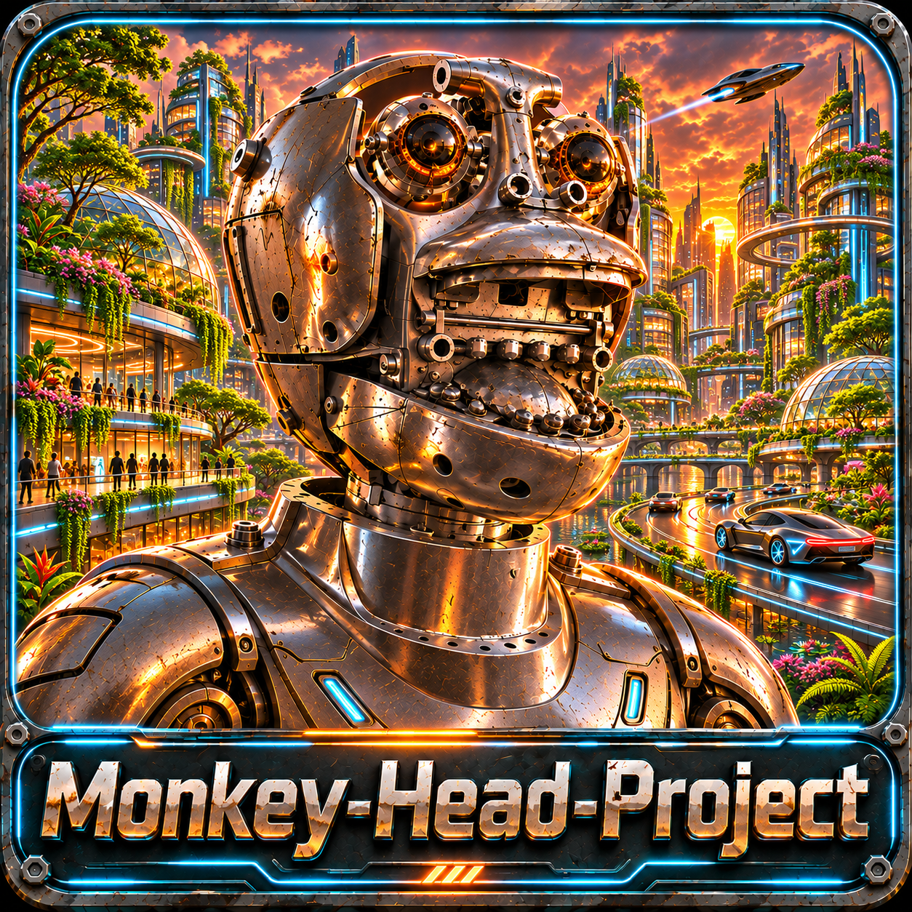

<h1 align="center">Monkey-Head-Project</h1>

  

<strong>Breathing new life into old tech.</strong>

  
  
  
  
  
  

> [!IMPORTANT]
> **[Master Plan V223](master-plan-v223.json) (November 15, 2026) describes the current architectural direction and is still a proposed, human-review-required master-plan document.** The choice of an **Interface Node** and **Huey Console** is an approved design direction, **not proof of an operational independent HueyOS core**. RC1.3 constitutional governance remains **proposed and unratified**. The Python distribution version (`hueyos 0.2.0`) is separate from the master-plan version.

[Master Plan V223](master-plan-v223.json) · [GitHub Wiki](https://github.com/DylanLRPollock/Monkey-Head-Project/wiki) · [Releases](https://github.com/DylanLRPollock/Monkey-Head-Project/releases) · [Issues](https://github.com/DylanLRPollock/Monkey-Head-Project/issues) · [Official website](https://www.dlrp.ca)

## Project Definition

The **Monkey-Head-Project** is the long-running umbrella project through which **HueyOS** and **Huey** are designed, built, documented, tested, and evolved.

**HueyOS is a modular, offline-first, distributed computing system**, not one computer, one GPU, a single LLM, or the workstation used to access it. Huey is the envisioned **physically embodied, constitutionally bounded collective** spanning model-serving, persistent identities, distinct Pebble contexts, messaging, governance, scheduling, and optional robotic interfaces. Those capabilities are at different stages of research and implementation; a functioning workstation is not evidence of an operating constitutional collective.

**“Breathing new life into old tech”** means reusing technology when it still provides demonstrable value. Hardware age alone is neither a reason to discard a component nor a reason to base the whole architecture on it. Support horizon, energy consumption, performance, cost, reliability, safety and repairability determine appropriate roles.

Our design principles are:

- **Interface independence:** the human's workstation can be switched off without interrupting a *future qualified* HueyOS core; this requirement is not yet demonstrated.
- **Replaceable compute:** GPUs, CPU platforms, LLM backends and model sizes are selected by workload measurements, not locked to the existing Tesla V100.
- **Local-first operation:** core functions should be able to operate without mandatory cloud services; a temporary all-in-one lab build remains useful but is not a resilient deployment.
- **Bounded collective:** independent Pebble identities and authorization boundaries can share a model service without sharing private state or sovereign authority.
- **Embodied and safe:** perception, actuation and physical safety are separate, explicit responsibilities; emergency control cannot depend on LLM output.
- **Evidence before claims:** distinguish research, user-reported lab observations, tested behavior, approved design decisions, and completed systems.

## System Architecture

V223 separates **physical nodes** from **logical HueyOS services** and from **constitutional districts and Pebbles**. A single physical host may perform several roles; no GPU or node automatically constitutes a district or citizen.

| Component | Intended responsibility | Current status |
| --- | --- | --- |
| **Interface Node** | Human access, development, monitoring, configuration and optional auxiliary computation | Existing i9 workstation; functional lab environment |
| **Huey Console** | Human-facing application/session through which authorized users access HueyOS | Proposed unified interface; PyHuey/PyGPT provide development foundations |
| **HueyOS core** | Essential orchestration, identity/permissions, durable messaging, governance workflows and state coordination | Architecture defined; **independent runtime not yet implemented** |
| **Compute Node(s)** | Advertise CPUs, GPUs, memory, topology, software capabilities and thermal/power limits; execute authorized workloads | Future hardware **not selected**; software simulation is the next step |
| **State / Storage Node role** | Serve authoritative Rock records, identity state, durable HIMS queues, checkpoints and tested backups | Requires an independent host before claiming i9-offline continuity |
| **Body / Embodiment Node role** | Sensors, audio, animatronics and actuators with independent safety controls | Huey V4 physical work continues; safe autonomous operation unqualified |

The **Huey Brain**, **Huey Farm** and **Huey Body** remain useful functional domains, not permanent assignments to one motherboard. The Brain comprises logical cognition, context boundaries, scheduling and authorized governance processes; the Farm supplies replaceable model/compute resources; the Body is the recoverable physical embodiment. The **Walnut** is the replaceable model-serving engine; the **Rock** is durable authorized records; **HIMS** is internal messaging; **Banana Brain** allocates and schedules work.

### Interface Node and Huey Console

The current **Intel i9-12900K workstation** is our first **Huey Interface Node**. It remains a development workstation, kernel testbench, visualization/rendering system and gateway for interacting with Huey. It can *also* contribute GPU jobs, cached models or backups while available. It must **not** become the sole keeper of authoritative identities, constitutional records, Rock state, or orchestration leases.

**Huey Console** names the user-facing software capability, **not the i9 itself**. Future authorized laptops, tablets, and other clients should be able to connect without going through that workstation. PyHuey/PyGPT integrations are candidates, not a claim that Huey Console is already fully built.

### Independent operation is an acceptance test, not a present capability

Eventually, powering down the i9 should close only its Console sessions and optional jobs. Essential HueyOS services must remain on independently powered, authenticated infrastructure. This requires real core/state hosting, recoverable records, server-side authorization, and successful shutdown/reconnect tests; none is established simply by a network diagram. Loss of all model/compute capacity may leave HueyOS preserving state in a safe degraded mode, **not continuing inference without a model**.

### Node contract and scheduling

V223 proposes a versioned node interface (working namespace **`huey.node.v1`**, **not an existing public API**) for identity-bound enrollment, capability advertisement, health/heartbeats, bounded work leases, checkpoints, result submission, cancellation and recovery. Banana Brain should schedule by measured capabilities, task priority, authorization, thermal headroom, model placement and fair compute budgets—not a fixed one-district-per-GPU mapping. Start with **simulated nodes on the i9**, then qualify a separate host.

**An Interface Node requests and observes; HueyOS core authorizes and coordinates.** A Console cannot bypass citizenship protections, rewrite signed votes, directly modify private vaults or override physical safety systems.

## Huey V4 Embodiment

**Huey V4** remains the active physical embodiment project, assembled from salvaged and reworked parts spanning earlier generations. **The body is not synonymous with HueyOS's core**, and the V223 node architecture does not require a particular workstation to remain physically attached to it.

### Rolling Audio Base

The reported V4 direction uses a salvaged rolling wooden base on **four 3-inch casters**, three speaker housings with **four speakers**, and a previously tested marine-grade amplifier. Metallic silver with purple/black accents remains the documented finish direction. Current assembly, wiring and paint status need a dated reinspection.

### Compute Midsection

The historical V4 plan uses a modified **Thermaltake Mozart** chassis, mounted on its left side and backwards on a bolted wooden interface. Earlier iterations described the **i9/Z790 workstation** as the local Brain in this midsection. **V223 supersedes that permanent runtime assignment**: physical mounting choices and eventual embodied compute/control placement remain open, while the working i9 is classified as an Interface Node.

### Animatronic Head

The head is a planned hybrid rebuild using parts from **two 2005 WowWee animatronic monkey heads**, preserving useful original mechanics and pursuing Arduino-class control. Final V4 mounting, safe actuation, and integrated testing are unverified. A possible hand/arm remains a future optional experiment. Hardware interlocks and safe-stop behavior are required independently of Huey Console, HIMS and Walnut.

## Compute and Hardware Direction

**No production compute GPU, motherboard, CPU, accelerator count, or VRAM total is selected by V223.** The existing single-V100 workstation is a useful testbench—not a procurement template. Previously studied four-, seven- and eight-V100 configurations, Gigabyte MZ32-AR0, AMD EPYC 7402P, and server chassis are **comparative research only**.

| Area | Existing i9 Interface Node / current direction |
| --- | --- |
| **CPU / motherboard** | Intel **Core i9-12900K**, ASUS **TUF Z790-PLUS WIFI** |
| **OS / desktop** | Debian Forky, GNOME Wayland (reported); experimental kernels are not automatically accepted |
| **RAM** | Two DDR5 modules reported; previous 16 GiB total figure needs revalidation |
| **GPU acceleration** | **One NVIDIA Tesla V100 PCIe 32 GiB**, GV100/Volta `sm_70`; retained for development and optional auxiliary AI jobs |
| **Graphics** | AMD **RX 570 8GB** currently drives the display; Intel UHD 770 migration remains a separate unverified possibility |
| **NVIDIA driver** | Known-good **proprietary R580 580.196.07**, documented on this host |
| **CUDA** | CUDA Toolkit **12.9.86** reported; `nvidia-smi` **CUDA 13.0** is *driver compatibility*, not the toolkit version |
| **Power** | Existing **1000W PSU** reported; no second power supply mandated by V223 |
| **Optane system volume** | **4 × Intel Optane M10 16GB**, reported working **RAID10**, about **32GB usable**; array topology to be audited |
| **Home SSD volume** | Two 2.5-inch SSDs in a reported **striped** `/home` array, approximately **400GB+ usable**; stripe provides **no disk redundancy** |
| **Bulk storage** | Two 10TB-class WD hard drives used for slower storage/mirroring and backup copies; exact RAID/Btrfs profile and restore tests still require verification |

The existing **three-tier storage design stays in place** unless measurement or safety demands a change. It is valuable for the i9 lab and optional archives, but it **cannot be the sole live Rock or identity store** if HueyOS must continue after the i9 shuts down. RAID is not an independent backup; especially protect the striped `/home` with tested recoverable copies.

The V100 can support useful workloads such as transcription, embeddings, image generation, testing and compatible local inference. Its **Volta software-support limitations** require pinned/qualified toolchains. Previously reported hot GPU observations justify verifying directed airflow before sustained loads. The RX 570 display path and working NVIDIA/CUDA environment should be preserved during kernel experimentation.

### Selecting the future compute platform

First identify a model and workload that satisfy Huey's requirements for reasoning, tool use, context length, latency, concurrent Pebble requests and reliability. Then compare compatible GPUs, usable VRAM **including KV-cache overhead**, supported quantization formats, throughput, energy, software longevity, landed cost in **CAD**, PCIe/interconnect topology, cooling and power. Select motherboard/CPU/RAM **after** these needs are understood.

**Aggregate VRAM does not become one coherent memory pool simply by installing several cards.** Model sharding and peer-to-peer transfer require explicit runtime/topology tests. A larger model or an older/cheaper card is not automatically the better engineering choice. No additional V100 purchase is a V223 prerequisite.

[Verified V100 driver baseline](docs/hardware/tesla-v100-nvidia-driver-baseline.md) · [Hardware Wiki](https://github.com/DylanLRPollock/Monkey-Head-Project/wiki/Hardware) · [Distributed Computing Wiki](https://github.com/DylanLRPollock/Monkey-Head-Project/wiki/Distributed-Computing)

## Cognition Stack

The **Walnut** is Huey's replaceable local model service, not an unrestricted controller. **V223 prefers one main shared Walnut serving multiple separately bounded Pebble identities and contexts**, with specialist or testing models permitted. Sharing weights must never silently merge private memory, credentials, civic privileges, or tool access. Distinct contexts are an engineering design; **they do not by themselves establish independent consciousness, agency or constitutional citizenship**.

### Operator and development runtime

**PyHuey/PyGPT** are current integration and development foundations; the production **Huey Console** is not yet qualified.

- **Python:** `pyproject.toml` declares `>=3.13,<3.14`; Python 3.13 is the supported release target.
- **Package identity:** the distribution is `hueyos` (last inspected release metadata `0.2.0`), while the import tree is `src/huey`.
- **Ollama:** local model execution on the single V100 has been demonstrated with a reported Qwen-class model; not the distributed production Walnut.
- **RAG:** PyGPT with EmbeddingGemma-based retrieval has passed a local test; this is **not** the durable, authorized Rock.
- **ComfyUI:** CUDA FP16 image-generation testing succeeded; integration through resource-aware scheduling remains work.
- **Audio:** Whisper/faster-whisper transcription is a useful candidate auxiliary task for the existing V100; live HueyOS integration remains unqualified.
- **Video, vision, TTS and other model backends:** optional research, not core capabilities already proven.

### Banana Brain

[Banana Brain](https://github.com/DylanLRPollock/Monkey-Head-Project/wiki/Banana-Brain) is the foundation for shared GPU/CPU resource management: job records, quotas/reservations, telemetry, priorities, watchdogs and adapters. **V223 locates orchestration as a portable HueyOS core service, not a privilege of the i9's GUI.** Existing single-host code does not prove authenticated multi-node allocation, exactly-once side effects, live failover, cross-node state recovery or a qualified shared-Walnut schedule.

### Model research

**`gpt-oss-120b` and other large open-weight models remain candidates, not requirements.** V100 `sm_70` does not provide the modern numerical-format support assumed by some native runtimes. Choose inference backends, numerical formats and target hardware by reproducible model-fit/performance tests. Favor intra-node GPU sharding for communication-sensitive model partitions unless cross-node bandwidth measurements justify another design.

## Pebbles, Districts, and the Atom

V223 retains the **proposed, unratified RC1.3 collective specification**. Constitutional districts and Pebble identities are **logical**; they do not correspond one-to-one with physical nodes, GPUs or model processes.

- **Founding research model:** 64 original citizen configurations → 128 → **256 proposed citizens** through two generations of exact bifurcation; this population is **not deployed**.
- **Districts:** four founding logical districts with **64 proposed citizens each**; a district is not an accelerator assignment.
- **Pebble:** a proposed bounded, persistent civic/context identity with specific permissions, lineage, role and private-memory boundaries.
- **Atom:** historical alias for a four-district grouping.
- **Exact bifurcation:** one active original retires and two distinct descendants carry an authorized ancestral reference, separate new credentials and divergent future memory.
- **Augmented bifurcation:** a parent continues while an authorized new identity inherits selected traits, **not** the parent's private vault by default.

Individual Pebble isolation must be enforced by identity, permissions, durable state, per-context reset and audited tool execution. Scheduling multiple prompts against one shared LLM does **not** independently validate civic identity or cognition.

### The Pulse

RC1.3 research retains the proposal of **four minutes unified plus four minutes diversified** computation. It has not been benchmarked or approved as a live operating guarantee. Model/context switch costs, restoration, latency, fairness and thermal pressure must be measured. Safety protections preempt the Pulse.

[Collective Wiki](https://github.com/DylanLRPollock/Monkey-Head-Project/wiki/Pebbles-and-Districts) · [Memory Architecture](https://github.com/DylanLRPollock/Monkey-Head-Project/wiki/Memory-Architecture)

## Governance and Constitution

The **Third-Generation RC1.3 Constitution** is the unchanged proposed constitutional design carried into V223: Preamble, ten chapters, unexecuted Closing/Ratification and nine proposed Schedules. Its research series is non-normative. **No ratification has occurred and constitutional offices are not operationally qualified.**

| Institution | Proposed organization |
| --- | --- |
| **Senate** | Eligible active citizens not presently holding executive or judicial office |
| **President** | **One**, directly elected by eligible citizens; four-month term, maximum four consecutive terms followed by a one-term cooloff |
| **Supreme Court** | **Four Justices**, one elected from each founding District; **three lawful concurrences** required for any binding judgment |
| **Founding Father** | Founding bootstrap with limited independently constrained advisory and preservation functions |
| **Human Counterpart** | Retains project authorship/canon and human maintenance authority, separate from proposed internal civic offices |

**Proposed voting thresholds:** For each signed frozen eligible roll `E`, count authenticated Yes (`Y`), No (`N`), Abstain (`A`), valid participation `P=Y+N+A` and substantive votes `S=Y+N`. A District block requires `P >= ceil(4E/5)` and `S >= ceil(2E/3)`. Authenticated abstentions count toward participation but not substantive turnout; they are not presumed incapacity or wrongdoing.

- **Ordinary law:** `Y > N` in each approving valid District, with **three of four** positive blocks required (plus other lawful stages).
- **Special District votes:** `Y >= ceil(2S/3)` across at least three valid District blocks, where applicable.
- **Founding ratification:** `Y >= ceil(2E/3)` in **all four** founding Districts, with independent certification and the applicable turnout rules.

These are **proposed constitutional procedures**, not operational elections or permissions. They supersede the older V220 description of **128 job roles per District, three Justices and routine Founder tie-breaking**. There are **five proposed active special offices**: one President and four Justices.

Neither AI-generated office titles nor HIMS sender names constitute authenticated authority. Physical safety and host privilege checks remain separate.

[Constitution and Governance Wiki](https://github.com/DylanLRPollock/Monkey-Head-Project/wiki/Constitution-and-Governance)

## Memory and HIMS

### Persistent records and the Rock

The documented canonical **HoneycombStorage** implementation uses **JSON files**, not SQLite; a different **HoneycombStore** is in-memory. Banana Brain's job store uses SQLite. Existing local file ingestion, indexing and retrieval are useful prototypes, but are **not** yet an independently available authoritative **Rock**, secure Pebble vault or transactional, authenticated governance record.

V223 requires durable operational state (identity/permissions, Rock, HIMS queues, scheduler leases/checkpoints and audit trails) to reside on infrastructure **independent of the optional i9 Interface Node** before any claim of i9-offline continuity. This requires backups with verified restores, clear key custody, replay-safe mutations and tested disconnection/reconnection. Using the i9's existing RAID for development or replicated backups is fine; making it the **only** source of truth is not.

### HIMS — Huey Internal Messaging System

The repository has several distinct messaging representations; they must not be described as one finished encrypted network:

1. `huey.messaging`: local append-only JSONL messages and lifecycle events.
2. `huey.hims`: earlier ShadowHIMS/ThunderMail mailbox, validation and ledger components.
3. `huey.core.messaging`: structured transport-independent envelopes.

Future consolidation requires explicit authenticated node identity, sender/recipient authorization, confidential transport where required, replay resistance, schema migration, recoverable queues and audit. **Messaging is not authority to act.** In particular, Interface Node requests cannot substitute for server-side governance and tool-permission checks.

[HIMS Wiki](https://github.com/DylanLRPollock/Monkey-Head-Project/wiki/HIMS) · [Memory Architecture Wiki](https://github.com/DylanLRPollock/Monkey-Head-Project/wiki/Memory-Architecture)

## Security and Safety

HueyOS must separate **AI proposals**, **authenticated identities**, **capability authorization**, **operating-system privileges**, **civic decisions**, and **independent physical safety**.

The repository includes privileged-operation checks, named API operator/admin credentials, selected task-owner controls, explicit confirmation requirements and structured decision logging. These are meaningful foundations, not a complete verified security system. External identity, third-party plugin capability coverage, tamper-resistant audit records, encrypted collective messaging and private Pebble vaults remain incomplete.

The dated security risk register also requires independent confirmation that an earlier exposed credential was revoked and its usage reviewed. Removing it from live documentation did not revoke it.

Physical emergency controls must not depend on LLM judgment, HIMS delivery or governance timing. V4 requires verified electrical protection, cooling, mechanical safe states and an appropriately engineered emergency stop. The proposed Yellow/Orange/Red escalation model does not replace these controls.

[Security and Safety Wiki](https://github.com/DylanLRPollock/Monkey-Head-Project/wiki/Security-and-Safety) · [Security Risk Register](docs/security/current-risk-register-2026-11-03.md)

## LabTech

**LabTech is external development and support technology, not part of Huey's civic identity or essential runtime.** The i9's new **Interface Node** role is a HueyOS client/resource-provider classification, not a return to permanent Brain ownership.

Documented examples include the **ASUS FX505DT** mobile lab machine and the **Lenovo Legion Go** support/diagnostic device. Other experimental terminals may assist with SSH, maintenance, transcription and recovery. Their current configurations should be checked individually.

## Development Status and Priorities

The [Development Roadmap](https://github.com/DylanLRPollock/Monkey-Head-Project/wiki/Development-Roadmap) describes earlier work. **V223's new priorities emphasize the node contract and independent authoritative state before hardware expansion**.

### Dated quality evidence — November 13, 2026

The earlier review recorded `hueyos` 0.2.0, Python 3.13 support, an **80%** combined coverage gate (with a later **90%** goal), and a historical full-suite result from PR #923 of **888 passed, 16 skipped, 59.84% coverage**. At that review, CI had a pytest collection conflict and kernel-builder Ruff diagnostics. **These are dated observations, not a claim that the current main branch is still failing or now passing.** Re-run and record current checks before release acceptance.

### V223 implementation sequence

1. **Preserve the working i9 Interface Node.** Record its RAID/storage topology, independent backups, NVIDIA driver/CUDA baseline and safe rollback without disrupting working hardware.
2. **Continue kernel engineering in parallel.** A separate workstream is developing an experimental Linux **7.3.4-huey** kernel; testing/rollback are independent and no installed or stable release is implied.
3. **Prototype Huey Console and the node contract** with authenticated simulated compute and storage workers. Demonstrate joining/leaving, capability changes, lease expiration, cancelled jobs and client reconnect.
4. **Make critical services independent of the i9.** Select a separately powered core/state host, implement authorized Rock/HIMS/scheduler persistence, and demonstrate safe shutdown and reattachment of Interface Nodes.
5. **Qualify the shared Walnut and bounded Pebble contexts.** Test privacy, isolation, fairness, quotas, model restart, authorized tool use and useful agent performance.
6. **Size compute hardware from evidence.** Compare model quality, VRAM/headroom, throughput, power, driver support and Canadian costs *before* purchasing a dedicated accelerator node.
7. **Continue V4 embodiment and RC1.3 research independently.** Prove physical safe-stop and constitutional/identity evidence before claiming autonomous operation or an enacted government.
8. **Reconcile documentation.** Align the Wiki, hardware notes and website to V223 after review; do not silently rewrite their historical record.

The custom kernel builder may create and verify build artifacts, but installation, reboot and production acceptance require explicit human-controlled procedures. **No current GPU purchase, kernel change or constitutional activation follows automatically from this README.**

[Testing and Quality Assurance](https://github.com/DylanLRPollock/Monkey-Head-Project/wiki/Testing-and-Quality-Assurance) · [Kernel Upgrade Runbook](docs/runbooks/huey-kernel-upgrade.md) · [GitHub Actions](https://github.com/DylanLRPollock/Monkey-Head-Project/actions)

## Documentation and Canon

| Source | Authority and purpose |
| --- | --- |
| **[Master Plan V223](master-plan-v223.json)** | Complete machine-facing **proposed** plan, November 15, 2026. Contains the approved architectural direction alongside explicitly unimplemented requirements and preserved historical research |
| **Historical V222 / V221** | Design lineage and provenance retained inside V223; superseded hardware targets are not current procurement commitments |
| **RC1.3 Constitution and Schedules** | Unchanged **proposed, unratified** internal governance framework |
| **RC1.3 Research** | Supporting non-normative experiments and analysis |
| **README** | Human-facing explanation of the current direction and dated capability evidence |
| **[GitHub Wiki](https://github.com/DylanLRPollock/Monkey-Head-Project/wiki)** | Detailed project documentation, requiring independent V223 terminology reconciliation |
| **[dlrp.ca](https://www.dlrp.ca)** | Public project narrative; V223 website synchronization is not claimed |

**Only Dylan L.R. Pollock may approve canonical project design changes.** A README update, an LLM response, a branch, a model-generated office, or an unratified constitutional simulation cannot independently enact project policy or civic authority.

Architectural decisions are not deployment evidence. Every hardware, security, integration and governance claim should retain its source, status and review date.

## License and Provenance

Project code is licensed under **GPL-3.0**, with current package metadata declaring **`GPL-3.0-only`**. Check repository license files and each third-party component/model/asset's terms for precise redistribution obligations.

Earlier shells, Raspberry Pi experiments, historical Federation and Huey Core terms, the old permanent i9 Brain placement, and studied multi-V100/EPYC designs remain valuable **documented project history**, not active V223 hardware requirements.

**Breathing new life into old tech** is a discipline of sustainable engineering—not a requirement to keep any particular obsolete part in the critical path.

---

<strong>Breathing new life into old tech.</strong>

