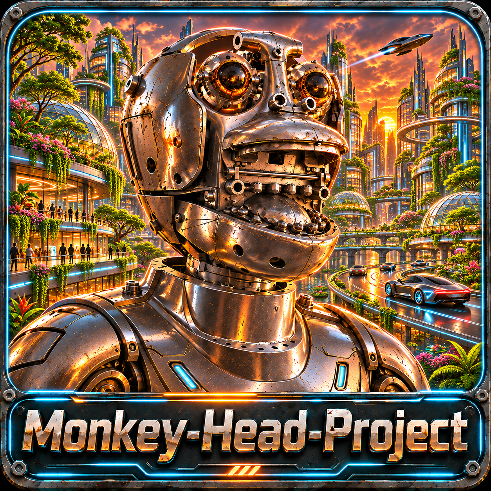

<h1 align="center">Monkey-Head-Project</h1>

  

<strong>Breathing new life into old tech.</strong>

  
  
  
  
  
  

> [!IMPORTANT]
> **Master Plan V222 Revision 2 (November 13, 2026) is a proposed design candidate requiring human review.** It is not a software release, an operating four-GPU collective, or a ratified Constitution. The tracked `master-plan-v221.json` remains the published predecessor until V222 artifacts are separately approved and committed. The Python distribution version (`hueyos 0.2.0`) is not the master-plan version.

[GitHub Wiki](https://github.com/DylanLRPollock/Monkey-Head-Project/wiki) · [Releases](https://github.com/DylanLRPollock/Monkey-Head-Project/releases) · [Issues](https://github.com/DylanLRPollock/Monkey-Head-Project/issues) · [Official website](https://www.dlrp.ca)

## Project Definition

The **Monkey-Head-Project** is the long-running umbrella project through which **Huey** is designed, built, documented, tested, and evolved.

Huey is not simply a chatbot, a workstation, or an AI model mounted inside a robot. It is a **locally operated, physically embodied AI system** built around modularity, reuse, expandability, repairability, compartmentalized cognition, and eventual autonomous operation. The physical machine, local compute, model runtime, memory, internal messaging, governance, sensors, actuators, and operator interfaces are intended to function as parts of one evolving system.

The project's philosophy — **"Breathing new life into old tech"** — is both aesthetic and architectural. Huey deliberately combines salvaged, repurposed, older, and newer technology where it remains useful, rather than treating every generation as disposable.

Core direction:

- **Local first:** Huey should remain capable of meaningful local/offline operation without making cloud access part of its identity.
- **Physically embodied:** sensing, actuation, audio, thermals, power, safety, and environmental interaction are first-class parts of the system.
- **Modular and expandable:** components should be replaceable, repairable, and able to grow without requiring the entire project to be redefined.
- **Governed and compartmentalized:** the language model is a bounded reasoning component inside a larger framework of jobs, permissions, memory, messaging, and checks and balances.
- **Node-first:** the first Huey must be a valid standalone physical system before any future multi-Huey federation is required.

## System Architecture

Huey is presently organized around three broad architectural domains:

| Domain | Role |
| --- | --- |
| **Huey Brain** | Local cognition, orchestration, operator interaction, model access, memory/state coordination, evidence, logging, and governance execution. |
| **Huey Body** | Physical embodiment: sensing, actuation, audio, animatronics, power, cooling, environmental interaction, physical safety, and recoverable control. |
| **Huey Farm** | Expandable accelerator, model, storage, and support capacity used by the Huey node, including the planned four-V100 compute architecture. |

These domains are useful boundaries, not separate identities. Huey is intended to emerge from the **governed interconnected whole** rather than from one unrestricted model or one piece of hardware.

The local language model is deliberately treated as the **"walnut"**: an encapsulated language/reasoning engine that does what an LLM does best while remaining constrained by Huey's surrounding framework. The model does not receive the keys to the whole system. Access to sensors, storage, tools, actuation, governance, and other capabilities is intended to remain explicit, compartmentalized, and auditable.

A single physical Huey may itself contain a large internal collective of sandboxed jobs and compute districts. That internal collective is still **one Huey node** and is distinct from the longer-term possibility of coordinating multiple separate Huey machines.

## Huey V4 Embodiment

**Huey V4** is the active physical build. It is a synthesis of earlier project generations rather than a clean replacement of them, carrying forward useful materials, parts, mechanical ideas, and visual identity from V1 through V3.

The V4 physical stack is being assembled in three major layers:

### Rolling Audio Base

The bottom section is a sturdy salvaged wooden structure riding on **four 3-inch caster wheels**. It contains three speaker housings and **four speakers total**: two in the centre housing and one in each side housing. The marine-grade stereo/amplifier has already been tested successfully; parts of the audio assembly are presently disassembled or unwired as needed during painting and finishing.

The current finish uses **white primer beneath a metallic-silver colour coat**, with deep purple and black retained as accent directions. No clear coat is presently planned.

### Compute Midsection

A smaller wooden interface platform joins the rolling base to a heavily modified **Thermaltake Mozart** chassis, historically nicknamed the **"black box."** The chassis is secured through the wooden platform with three bolts and is mounted on its **left side and backwards relative to its original orientation** to better suit the V4 physical stack, airflow, and future cooling layout.

This midsection houses the primary workstation architecture built around:

- **Intel Core i9-12900K**
- **ASUS TUF Gaming Z790-Plus WiFi**
- local storage, PCIe expansion, and the developing multi-accelerator topology

### Animatronic Head

The V4 head is **not yet mounted**. The target is a hybrid rebuild using the best surviving plastic, mechanical, and animatronic parts from the project's **two 2005 WowWee animatronic monkey heads**.

The first head had its rubber removed, was reduced toward its essential shell and mechanisms, painted metallic silver, and became the visual identity carried through V1, V2, and V3. The second unit is now part of the donor/rebuild path for V4.

Current direction is to preserve useful original mechanisms where practical, retain at least basic mouth movement, use Arduino-class control, and evaluate a detachable mounting design without unnecessarily gutting functional hardware.

An animatronic hand/arm remains a future experimental peripheral rather than a V4 bring-up requirement.

## Compute and Hardware Direction

The primary **i9** workstation is a verified single-V100 Debian development environment. A four-V100 accelerator system is a target, not a completed deployment.

| Area | Current evidence or future direction |
| --- | --- |
| **CPU / motherboard** | Intel Core i9-12900K; ASUS TUF GAMING Z790-PLUS WIFI |
| **OS / desktop** | Debian Forky; GNOME Wayland reported. The running kernel must be rechecked before upgrades. |
| **System RAM** | 16GiB last reported; large-model loading may require more |
| **Installed accelerator** | **One NVIDIA Tesla V100 PCIe 32GB**, Volta/GV100, compute capability 7.0, bus `00000000:01:00.0` |
| **Display GPU** | AMD RX 570 8GB using `amdgpu` / Mesa RADV |
| **NVIDIA driver** | **Proprietary Linux 580.196.07 (R580)**, verified by `nvidia-smi` and `modinfo` |
| **CUDA compatibility** | `nvidia-smi` reports **13.0** (driver API compatibility, not the installed CUDA Toolkit) |
| **Toolkit** | CUDA Toolkit **12.9.86** at `/usr/local/cuda-12.9` last reported; verify via `nvcc --version` |
| **DKMS** | NVIDIA 580.196.07 builds documented for kernels `7.2.12+deb14-amd64` and `7.2.15+deb14-amd64`; later kernels not automatically qualified |
| **Accelerator target** | **4 × Tesla V100 PCIe 32GB = 128GiB nominal aggregate VRAM**; three additional cards not yet verified installed |
| **PCIe** | CPU x16 plus narrower chipset-connected expansion; P2P, lane placement and effective multi-GPU throughput unverified |
| **Power** | Two 1000W PSUs proposed; connector assignment, transients and load distribution require electrical qualification |
| **Cooling** | Directed air cooling for passive V100s; external liquid loop remains paused future work |
| **OS storage** | Four Optane M10 16GB drives in RAID10 is a target, not an accepted deployment |
| **Home storage** | Long-term device/filesystem unresolved |
| **Bulk storage** | Two 10TB-class WD drives; planned Btrfs RAID1 at `/10TB`. Verify actual data/metadata profiles, SMART and independent backup. |

**Thermal caveat:** A November 11 snapshot recorded the V100 at **86°C** with low reported utilization. This merits inspection of airflow and thermal conditions before sustained multi-GPU load; it does not alone establish the cause.

Aggregate VRAM is **not** one transparent unified allocation. PCIe extenders do not create extra host lanes. A working NVIDIA driver is not proof that distributed inference, GPU P2P, CUDA Toolkit, Vulkan/Proton and all future kernels are compatible.

The R580 driver is a **host-installed proprietary driver**, not a Python package dependency. Retain the known-good driver/kernel combination and RX 570 display path during upgrades.

[Verified V100 driver baseline](docs/hardware/tesla-v100-nvidia-driver-baseline.md) · [Hardware Wiki](https://github.com/DylanLRPollock/Monkey-Head-Project/wiki/Hardware) · [Distributed Computing](https://github.com/DylanLRPollock/Monkey-Head-Project/wiki/Distributed-Computing)

## Cognition Stack

The **Walnut** is Huey's replaceable local inference layer, not an unrestricted controller. Model-generated text must pass the appropriate tool, storage, messaging and physical-safety boundaries.

### Operator Runtime

**PyHuey** integrates with upstream PyGPT through the `huey-pygpt` entry point and a read-only MCP bridge. The user-tested environment includes PyGPT-Net **2.9.1** with local inference and retrieval. Full Huey-native orchestration and permission integration remain work in progress.

- **Python:** `pyproject.toml` declares `>=3.13,<3.14`; 3.13 is supported, 3.14 experimental, 3.12 legacy compatibility only.
- **Package naming:** distribution `hueyos`, maintained import root `huey`; these are different concepts.
- **Ollama:** local service with the reported `qwen3.6:35b` model running on one V100; the separate Python client dependency is `ollama==0.6.3`.
- **RAG:** a local PyGPT/EmbeddingGemma demo (768-dimensional embeddings reported) successfully retrieved a test record; this is not yet the durable Rock.
- **ComfyUI:** image generation demonstrated with CUDA FP16 and FP32 VAE, using a dedicated environment; workload scheduling and PyGPT integration still need end-to-end tests.
- **Audio:** faster-whisper transcription is a development direction; quality and system integration remain unqualified.
- **Video, vision and local TTS:** experimental candidates, not accepted core capabilities.

### Banana Brain

[Banana Brain](https://github.com/DylanLRPollock/Monkey-Head-Project/wiki/Banana-Brain) provides the single-V100 resource-scheduling foundation: job storage, VRAM reservations, telemetry, priority handling, watchdog and Ollama/ComfyUI/audio adapters. Its main composition root still needs complete constructor/service wiring and operational testing. Standalone Ollama and ComfyUI success must not be mistaken for an accepted combined scheduler.

### Large-Model Research

**`gpt-oss-120b` remains a research target**, not a model proved to work on four Volta GPUs. Native MXFP4 execution requires newer NVIDIA hardware than the V100's compute capability 7.0. Compatible alternate formats, kernels, quantization or models must be measured, not inferred from memory capacity alone.

## Pebbles, Districts, and the Atom

The **proposed V222/RC1.3** internal collective consists of logical identities within **one Huey node**—not one language-model process per citizen.

- **Founding model:** 64 original citizen configurations → 128 → **256 provisional citizens** through two generations of exact bifurcation.
- **Districts:** Four founding Districts with **64 provisional citizens each**; preferred one-to-one V100 mapping remains a proposed diversified compute configuration.
- **Pebble:** A bounded persistent logical citizen with identity, role, permitted actions, private memory and accountability.
- **Atom:** Historical name for the four-District grouping.
- **Exact bifurcation:** The original active identity retires; two distinct descendants receive an approved ancestral reference, new credentials and separate future memory.
- **Augmented bifurcation:** A parent continues while a derived citizen receives selected traits and its own identity; private vault contents are not automatically inherited.

The founding population, protected vaults, lineage system and identity registry are **not yet implemented or activated as a constitutional republic**.

### The Pulse

V222 proposes **four minutes unified** plus **four minutes diversified** computation (eight-minute cycle). The actual cost of switching distributed/independent models, restoring contexts, moving data and synchronizing records is unmeasured. Safety protection must preempt the Pulse.

[Collective Wiki](https://github.com/DylanLRPollock/Monkey-Head-Project/wiki/Pebbles-and-Districts) · [Memory Architecture](https://github.com/DylanLRPollock/Monkey-Head-Project/wiki/Memory-Architecture)

## Governance and Constitution

The **Third-Generation RC1.3 Constitution** is the proposed V222 constitutional design: Preamble, ten chapters, unexecuted Closing/Ratification and nine proposed Schedules. Its research series is non-normative. **No ratification has occurred and constitutional offices are not operationally qualified.**

| Institution | Proposed organization |
| --- | --- |
| **Senate** | Eligible active citizens not presently holding executive or judicial office |
| **President** | **One**, directly elected by eligible citizens; four-month term, maximum four consecutive terms followed by a one-term cooloff |
| **Supreme Court** | **Four Justices**, one elected from each founding District; **three lawful concurrences** required for any binding judgment |
| **Founding Father** | Founding bootstrap with limited independently constrained advisory and preservation functions |
| **Human Counterpart** | Retains project authorship/canon and human maintenance authority, separate from proposed internal civic offices |

**Proposed voting thresholds:** For each signed frozen eligible roll `E`, count authenticated Yes (`Y`), No (`N`), Abstain (`A`), valid participation `P=Y+N+A` and substantive votes `S=Y+N`. A District block requires `P >= ceil(4E/5)` and `S >= ceil(2E/3)`. Authenticated abstentions count toward participation but not substantive turnout; they are not presumed incapacity or wrongdoing.

- **Ordinary law:** `Y > N` in each approving valid District, with **three of four** positive blocks required (plus other lawful stages).
- **Special District votes:** `Y >= ceil(2S/3)` across at least three valid District blocks, where applicable.
- **Founding ratification:** `Y >= ceil(2E/3)` in **all four** founding Districts, with independent certification and the applicable turnout rules.

These are **proposed constitutional procedures**, not operational elections or permissions. They supersede the older V220 description of **128 job roles per District, three Justices and routine Founder tie-breaking**. There are **five proposed active special offices**: one President and four Justices.

Neither AI-generated office titles nor HIMS sender names constitute authenticated authority. Physical safety and host privilege checks remain separate.

[Constitution and Governance Wiki](https://github.com/DylanLRPollock/Monkey-Head-Project/wiki/Constitution-and-Governance)

## Memory and HIMS

### Persistent Storage

The canonical **HoneycombStorage** uses **JSON files**, not SQLite. There is also a separate **in-memory HoneycombStore**. The Banana Brain job store uses SQLite. File ingestion, structured indexes, metadata utilities, copy-based backups and local RAG experiments exist, but the proposed **Rock** and encrypted private Pebble vaults do not yet have qualified identity, authorization, transaction, encryption and recovery services.

### HIMS — Huey Internal Messaging System

The repository has three related, **noninterchangeable** messaging implementations:

1. `huey.messaging`: local append-only JSONL messages and lifecycle events.
2. `huey.hims`: earlier ShadowHIMS/ThunderMail mailboxes, validation and ledger.
3. `huey.core.messaging`: structured transport-independent envelopes.

Future work must reconcile their schemas while preserving records and tests. Sender authentication, message confidentiality, replay resistance, key management and cross-District delivery are not completed simply because local messages can be stored.

**The ability to communicate is not authority to act.**

[HIMS Wiki](https://github.com/DylanLRPollock/Monkey-Head-Project/wiki/HIMS) · [Memory Architecture Wiki](https://github.com/DylanLRPollock/Monkey-Head-Project/wiki/Memory-Architecture)

## Security and Safety

HueyOS must separate **AI proposals**, **authenticated identities**, **capability authorization**, **operating-system privileges**, **civic decisions**, and **independent physical safety**.

The repository includes privileged-operation checks, named API operator/admin credentials, selected task-owner controls, explicit confirmation requirements and structured decision logging. These are meaningful foundations, not a complete verified security system. External identity, third-party plugin capability coverage, tamper-resistant audit records, encrypted collective messaging and private Pebble vaults remain incomplete.

The dated security risk register also requires independent confirmation that an earlier exposed credential was revoked and its usage reviewed. Removing it from live documentation did not revoke it.

Physical emergency controls must not depend on LLM judgment, HIMS delivery or governance timing. V4 requires verified electrical protection, cooling, mechanical safe states and an appropriately engineered emergency stop. The proposed Yellow/Orange/Red escalation model does not replace these controls.

[Security and Safety Wiki](https://github.com/DylanLRPollock/Monkey-Head-Project/wiki/Security-and-Safety) · [Security Risk Register](docs/security/current-risk-register-2026-11-03.md)

## LabTech

**LabTech is external development and support technology, not part of Huey's Brain, Body, Farm, internal citizenship or identity.**

Documented examples include the **ASUS FX505DT** mobile lab machine and the **Lenovo Legion Go** support/diagnostic device. Other experimental terminals may assist with SSH, maintenance, transcription and recovery. Their current configurations should be checked individually.

## Development Status and Priorities

The [Development Roadmap](https://github.com/DylanLRPollock/Monkey-Head-Project/wiki/Development-Roadmap) separates current capabilities from proposed expansion.

### Quality Snapshot — November 13, 2026

- **Python:** package `hueyos` 0.2.0; supported Python 3.13.
- **Coverage:** enforced **80%** combined branch/statement floor over maintained `src/huey`; the subsequent goal is **90%** without manipulating scope.
- **Last documented full-suite result (PR #923, November 10):** **888 passed, 16 skipped, 59.84%** combined coverage; this remains below the 80% gate.
- **Checked November 13 CI:** pytest collection failed because an unqualified `conftest.py` import resolved to the wrong test fixture file; static-analysis also failed. The kernel-builder CI reported **182 Ruff diagnostics**. These runs do not certify a new full-suite coverage result.
- **Other checks:** CodeQL, Bandit, dependency scan, artifact/filesystem scan, package smoke, documentation and Scorecard passed in the reviewed snapshot, but do not override blocking jobs.

### Near-Term Priorities

1. Repair required CI, restore clean test collection, and measure full-source coverage.
2. Preserve the verified NVIDIA 580.196.07 / kernel / RX 570 operating environment and qualify V100 cooling.
3. Complete Banana Brain service wiring, VRAM enforcement, watchdog behavior and Ollama/ComfyUI/audio adapter integration.
4. Consolidate HIMS and Honeycomb, connect local RAG through supported interfaces, and test backup/restore.
5. Continue V4 rolling base, sound system, chassis and animatronic head integration with independent safety controls.
6. Verify Btrfs RAID1 profiles, SMART diagnostics and an independent recoverable backup.
7. Map PCIe, power and airflow before acquiring and installing all four V100s.
8. Benchmark compatible distributed inference, then incrementally prototype Pebble/District identity and isolation.
9. Review RC1.3 and the V222 master-plan candidate before any canonical ratification or institutional activation.

The custom kernel-builder framework is used for planning/building/verifying kernel artifacts; installation, reboot and rollback remain explicit human-operated activities.

[Testing and Quality Assurance](https://github.com/DylanLRPollock/Monkey-Head-Project/wiki/Testing-and-Quality-Assurance) · [Kernel Upgrade Runbook](docs/runbooks/huey-kernel-upgrade.md) · [GitHub Actions](https://github.com/DylanLRPollock/Monkey-Head-Project/actions)

## Documentation and Canon

| Source | Role |
| --- | --- |
| **V222 Master Plan Revision 2** | Complete machine-facing **proposed** document dated November 13, 2026; requires human approval and separate publication |
| **`master-plan-v221.json`** | Existing tracked predecessor |
| **RC1.3 Constitution and Schedules** | Proposed, **unratified** internal governance |
| **RC1.3 Research** | Supporting non-normative analysis |
| **README** | Human-facing current repository context, capability status and links |
| **[GitHub Wiki](https://github.com/DylanLRPollock/Monkey-Head-Project/wiki)** | Expanded project documentation; actual publication of each drafted page should be verified |
| **[dlrp.ca](https://www.dlrp.ca)** | Public narrative; V222 alignment has not been independently checked |

Measured hardware and current source code establish what works. A proposal does not become operational through documentation alone.

**Only Dylan L.R. Pollock can accept canonical project design changes.** A model, branch, draft document, Pebble or unratified governance simulation does not independently decide the project's canonical truth.

Documentation should preserve dates, source provenance, implementation status and outstanding qualification gates.

## License and Provenance

Project code is distributed under **GPL-3.0**, with the reviewed package metadata specifying `GPL-3.0-only`; consult the repository license files for precise redistribution obligations. Third-party software, models, media, firmware, drivers and documentation can carry different licenses.

Earlier shells, Raspberry Pi experiments, historical Federation work, legacy names and superseded architecture remain documented for provenance without overriding the reviewed V222 direction.

---

<strong>Breathing new life into old tech.</strong>

